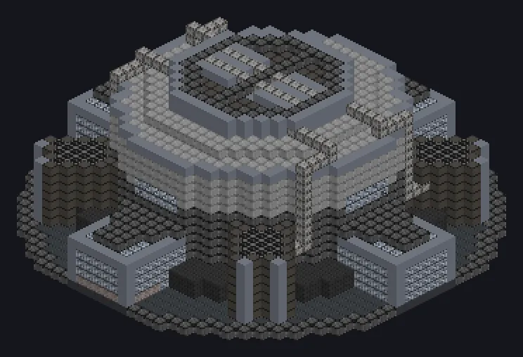

---
tags:
  - Multiblock catalog
---

# Advanced Fusion Reactor MK-I

<!-- Generated from the mod code; the structure shown is the smallest variant. -->

{ loading=lazy }

| | |
|---|---|
| **Recipe types** | Fusion Reactor |
| **Size** | 39 × 17 × 39 |
| **Blocks** | 6,459 |

## Description

It simulates the eternal light. modules raise its heat capacity, an overclock module unlocks special hatches.

- Machine Type: Fusion Reactor
- A modular fusion reactor: high-energy
- Each high-energy module doubles heat capacity
- Overclock module: Overclock and Thread Hatches
- Energy storage: 160M EU before modules
- Up to 4 high-energy modules, in order
- Only one overclock module
- On conflict, install high-energy modules first

## Structure

| Block | Qty |
|---|---:|
| Fusion Machine Casing | 1,534 |
| Pbi Radiation Resistant Mechanical Enclosure | 1,012 |
| Strengthen The Base Block | 940 |
| Nonconducting Casing | 819 |
| Improved Superconductor Coil | 584 |
| Fission Reactor Casing | 584 |
| High Strength Concrete | 396 |
| Naquadah Alloy Frame | 237 |
| Tungsten Frame | 164 |
| Fusion Glass | 80 |
| Electrolytic Cell | 60 |
| IV 256A Laser Target Hatch | 16 |
| ULV Input Hatch | 16 |
| ULV Output Hatch | 16 |
| Advanced Fusion Reactor MK-I | 1 |

<small>Generated from the mod code; the structure shown is the smallest variant.</small>
