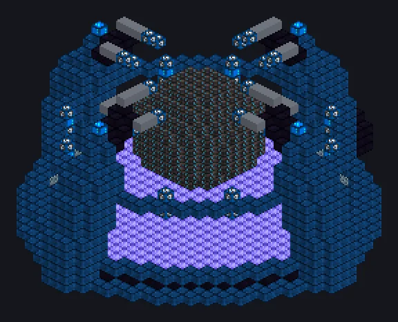

---
tags:
  - Multiblock catalog
---

# Advanced Hyper Reactor

<!-- Generated from the mod code; the structure shown is the smallest variant. -->

{ loading=lazy }

| | |
|---|---|
| **Recipe types** | Advanced Hyper Reactor |
| **Size** | 35 × 19 × 36 |
| **Blocks** | 2,720 |
| **Generator** | ✓ |

## Description

The Hyper Reactor, after a long talk with an echo. Burns concentrated hyper fuels; its boosters can be set per recipe.

- Machine Type: Generator
- Dynamo or Laser Source Hatch
- Booster plasma: 16x parallel by default
- Booster plasma is consumed once before a boosted run
- Booster and fuel are set per recipe (pack/KubeJS)

## Structure

| Block | Qty |
|---|---:|
| Dimensionally Transcendent Casing | 880 |
| Enhance Hyper Mechanical Casing | 774 |
| Degenerate Rhenium Constrained Casing | 489 |
| Hyper Core | 278 |
| Echo Casing | 144 |
| Naquadria Frame | 108 |
| Containment Field Generator | 32 |
| Dimensional Bridge Casing | 12 |
| ULV Input Hatch | 1 |
| Cleaning Maintenance Hatch | 1 |
| Advanced Hyper Reactor | 1 |

<small>Generated from the mod code; the structure shown is the smallest variant.</small>
