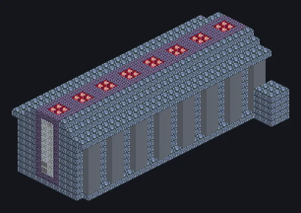

---
tags:
  - Electric processing
---

# Advanced Integrated Ore Processor

<!-- Generated from the mod code; the structure shown is the smallest variant. -->

*Why process one ore when you can process all of them?*

{ loading=lazy }

| | |
|---|---|
| **Machine type** | Integrated Ore Processing |
| **Category** | Electric processing |
| **Recipe types** | Integrated Ore Processing |
| **Size** | 15 × 12 × 32 |
| **Blocks** | 2,689 |
| **Origin** | GregTech Leisure |

## Description

Complete ore processing in one step, running several different recipes at once.

- Runs multiple different recipes at once
- Max parallel: 2,147,483,647
- Only accepts Laser Energy Hatches

## Structure

| Block | Qty |
|---|---:|
| Robust Tungstensteel Machine Casing | 1,325 |
| Tungstensteel Gearbox Casing | 512 |
| Tungstensteel Pipe Casing | 259 |
| HSS-S Frame | 256 |
| Sturdy HSS-E Machine Casing | 140 |
| Assembly Line Grating | 128 |
| Borosilicate Glass | 36 |
| Restraint Device | 32 |
| Advanced Integrated Ore Processor | 1 |

<small>Generated from the mod code; the structure shown is the smallest variant.</small>
