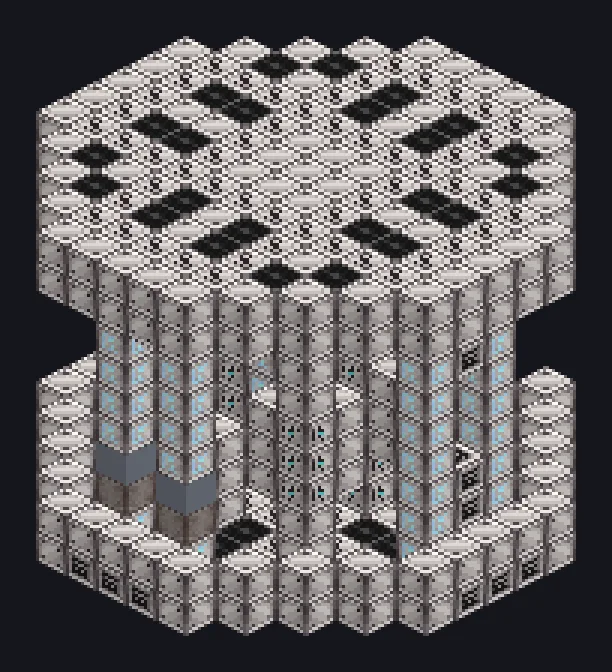

---
tags:
  - Multiblock catalog
---

# Analysis And Research Center

<!-- Generated from the mod code; the structure shown is the smallest variant. -->

{ loading=lazy }

| | |
|---|---|
| **Recipe types** | Data Analysis, Data Integration |
| **Size** | 13 × 11 × 13 |
| **Blocks** | 547 |

## Description

Feed it scans, get insight. Sometimes the insight you wanted. Turns scan data into research data with computation from the research network.

- Machine Type: Research
- Two modes: data analysis and data integration
- Each run yields one output, picked by its chance
- Needs a Computation Data Hatch and CWU/t

## Structure

| Block | Qty |
|---|---:|
| Computer Casing | 252 |
| Advanced Computer Casing | 143 |
| High Power Casing | 81 |
| Electrolytic Cell | 48 |
| Computer Heat Vent | 17 |
| ULV Output Bus | 1 |
| Cleaning Maintenance Hatch | 1 |
| Analysis And Research Center | 1 |
| ULV Input Bus | 1 |
| ULV Energy Hatch | 1 |
| Computation Data Reception Hatch | 1 |

<small>Generated from the mod code; the structure shown is the smallest variant.</small>
