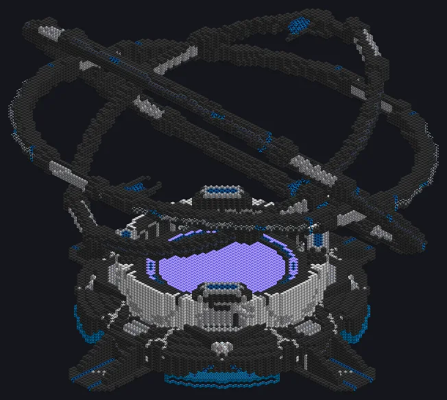

---
tags:
  - Catálogo de multiblocos
---

# Estrela Artificial

<!-- Página gerada a partir do código do mod; a estrutura é a menor variante. -->

{ loading=lazy }

| | |
|---|---|
| **Tipos de receita** | Gerador de Aniquilação |
| **Tamanho** | 121 × 112 × 109 |
| **Blocos** | 37.144 |
| **Gerador** | ✓ |

## Descrição

Faça-se a luz. Muita luz. Uma estrela artificial que gera energia com receitas de aniquilação.

- Tipo de Máquina: Gerador de Aniquilação
- Overclock perfeito: duração /4 por tier
- Saída por Laser ou até 16 Dynamo Hatches

## Estrutura

| Bloco | Qtd. |
|---|---:|
| Invólucro Hipermecânico | 17.604 |
| Invólucro de Liga de Naquadah | 11.539 |
| Invólucro de Constrição de Campo Graviton | 2.839 |
| Invólucro Receptor Dyson | 1.336 |
| Invólucro Constrito de Rênio Degenerado | 1.021 |
| Núcleo de Aniquilação | 977 |
| Invólucro de Controle Dyson | 628 |
| Invólucro Oco | 555 |
| Fusion Glass | 253 |
| Toroide de Controle Dyson | 213 |
| Vidro Energético Reforçado com Rênio | 152 |
| High Power Casing | 25 |
| Estrela Artificial | 1 |
| ULV Dynamo Hatch | 1 |

<small>Página gerada a partir do código do mod; a estrutura é a menor variante.</small>
