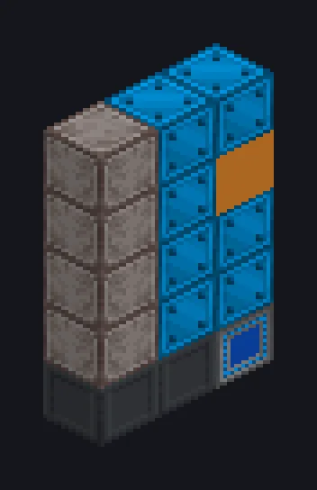

---
tags:
  - 终局系统
---

# 太空电梯组装模块

<!-- 根据模组代码生成;所示结构为最小形态。 -->

*插到太空电梯上，然后抬头看。*

{ loading=lazy }

| | |
|---|---|
| **机器类型** | 太空组装 |
| **分类** | 终局系统 |
| **配方类型** | 太空组装 |
| **尺寸** | 1 × 5 × 3 |
| **方块数** | 15 |
| **来源** | GregTech Odyssey |

## 说明

在轨道上组装零件，那里的零重力有助于实现最小的公差。

- 并行数：4^（动力模块 MK - 1）
- 仅在其太空电梯运行时工作

## 结构

| 方块 | 数量 |
|---|---:|
| 太空电梯机械方块 | 7 |
| 太空电梯模块基座 | 2 |
| 太空电梯模块连接器 | 1 |
| ULV能源仓 | 1 |
| ULV输入总线 | 1 |
| 太空电梯组装模块 | 1 |
| ULV输出总线 | 1 |
| ULV输入仓 | 1 |

<small>根据模组代码生成；所示结构为最小形态。</small>
