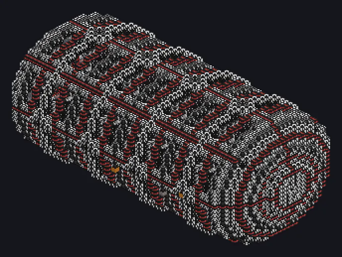

---
tags:
  - 终局系统
---

# 玻色-爱因斯坦凝聚态观测阵列

<!-- 根据模组代码生成;所示结构为最小形态。 -->

*它只制造看得见的东西。*

{ loading=lazy }

| | |
|---|---|
| **机器类型** | BEC观测阵列 |
| **分类** | 终局系统 |
| **配方类型** | 凝聚态组装 |
| **尺寸** | 61 × 31 × 31 |
| **方块数** | 7,994 |
| **来源** | GT: New Horizons |

## 说明

为通过视线连接器连接的传送节点提供纳米蜂群、EU 和网络凝聚态。

- 一个阵列可供能多个节点
- 纳米蜂群等级：总线中最低的等级
- 最多计入 30720 个纳米蜂群
- 阵列EU不足时节点停滞
- 超过 3 种非所需凝聚态会使配方失败

## 结构

| 方块 | 数量 |
|---|---:|
| 精细结构常数操纵器 | 1,700 |
| 相干保持等离子导管 | 1,515 |
| 电磁隔离机械方块 | 1,458 |
| 冲突诱导机械方块 | 838 |
| 和平维持机械方块 | 790 |
| 电磁波导 | 664 |
| 凝聚态转化线圈 | 560 |
| 凝聚态引导线圈 | 464 |
| 纳米蜂群容纳总线 | 1 |
| 玻色-爱因斯坦凝聚态观测阵列 | 1 |
| ULV能源仓 | 1 |
| 视线连接器仓 | 1 |
| 玻色-爱因斯坦凝聚态仓 | 1 |

<small>根据模组代码生成；所示结构为最小形态。</small>
