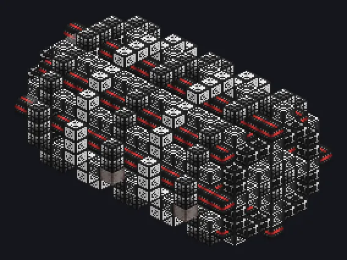

---
tags:
  - Catálogo de multiblocos
---

# Portão de Maxwell de Condensado de Bose-Einstein

<!-- Página gerada a partir do código do mod; a estrutura é a menor variante. -->

{ loading=lazy }

| | |
|---|---|
| **Tipos de receita** | Nenhum |
| **Tamanho** | 17 × 11 × 11 |
| **Blocos** | 620 |

## Descrição

O irmão mais velho do Demônio de Maxwell. o condensado do lado de entrada chega ao lado de saída.

- Tipo de Máquina: Portão de Maxwell BEC
- Deixa o condensado passar em um sentido:
- Filtros por tipo de condensado nos parâmetros
- Hatches de fluido definem os filtros
- Gasta 1A UIV enquanto ativo
- Bloqueia a rede enquanto desligado

## Estrutura

| Bloco | Qtd. |
|---|---:|
| Conduto de Plasma Preservador de Coerência | 148 |
| Carcaça de Indução de Conflito | 92 |
| Carcaça Eletromagneticamente Isolada | 89 |
| Manipulador da Constante de Estrutura Fina | 85 |
| Guia de Ondas Eletromagnético | 70 |
| Carcaça de Imposição da Paz | 68 |
| Bobina Transformadora de Condensado | 40 |
| Bobina Guia de Condensado | 24 |
| Hatch de Condensado de Bose-Einstein | 1 |
| ULV Energy Hatch | 1 |
| Portão de Maxwell de Condensado de Bose-Einstein | 1 |
| ULV Input Hatch | 1 |

<small>Página gerada a partir do código do mod; a estrutura é a menor variante.</small>
