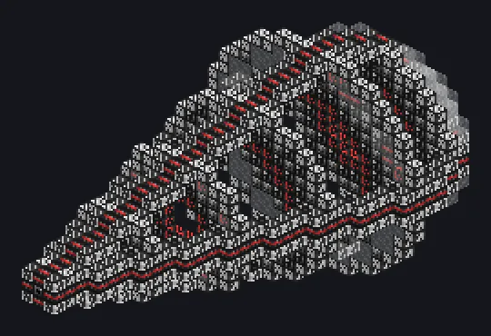

---
tags:
  - Catálogo de multiblocos
---

# Aparato de Emaranhamento de Condensado de Bose-Einstein

<!-- Página gerada a partir do código do mod; a estrutura é a menor variante. -->

{ loading=lazy }

| | |
|---|---|
| **Tipos de receita** | Emaranhamento de Condensado |
| **Tamanho** | 19 × 19 × 34 |
| **Blocos** | 1.279 |

## Descrição

Entra fluido, sai um fantasma. Transforma metais fundidos e fluidos em condensado emaranhado; o condensado vai direto para a rede.

- Tipo de Máquina: Gerador BEC
- Processa todos os fluidos dos hatches de uma vez
- Os paralelos sobem até o EU/t disponível
- O ciclo dura o da receita mais lenta
- Sem espaço na rede, o condensado é destruído

## Estrutura

| Bloco | Qtd. |
|---|---:|
| Carcaça de Indução de Conflito | 236 |
| Manipulador da Constante de Estrutura Fina | 232 |
| Conduto de Plasma Preservador de Coerência | 216 |
| Carcaça de Imposição da Paz | 184 |
| Carcaça Eletromagneticamente Isolada | 157 |
| Guia de Ondas Eletromagnético | 148 |
| Bobina Transformadora de Condensado | 101 |
| ULV Energy Hatch | 1 |
| ULV Input Hatch | 1 |
| Aparato de Emaranhamento de Condensado de Bose-Einstein | 1 |
| Hatch de Condensado de Bose-Einstein | 1 |
| ULV Input Bus | 1 |

<small>Página gerada a partir do código do mod; a estrutura é a menor variante.</small>
