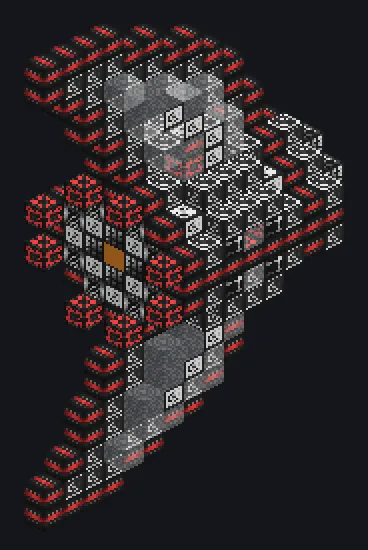

---
tags:
  - Endgame systems
---

# Bose-Einstein Condensate Teleportation Node

<!-- Generated from the mod code; the structure shown is the smallest variant. -->

*Items in, items out, physics optional.*

{ loading=lazy }

| | |
|---|---|
| **Machine type** | BEC Teleportation Node |
| **Category** | Endgame systems |
| **Recipe types** | Condensate Assembly |
| **Size** | 7 × 23 × 13 |
| **Blocks** | 430 |
| **Origin** | GT: New Horizons |

## Description

Crafts Condensate Assembly recipes with its buses; each item slot needs a nanite tier in turn.

- Extra nanites speed crafting linearly
- Min/max parallels and a speed divisor in the parameters
- Higher-tier nanites slow it by 2^(provided - required)
- Condensate may arrive at any time before the end
- No overclock
- Missing condensate at the end fails the recipe

## Structure

| Block | Qty |
|---|---:|
| Coherence Preserving Plasma Conduit | 94 |
| Conflict Inducement Casing | 88 |
| Electromagnetic Waveguide | 56 |
| Electromagnetically Isolated Casing | 48 |
| Fine Structure Constant Manipulator | 44 |
| Condensate Transformative Coil | 44 |
| Peace Enforcement Casing | 32 |
| Condensate Guidance Coil | 20 |
| ULV Input Bus | 1 |
| Bose-Einstein Condensate Teleportation Node | 1 |
| Line-Of-Sight Connector Hatch | 1 |
| ULV Output Bus | 1 |

<small>Generated from the mod code; the structure shown is the smallest variant.</small>
