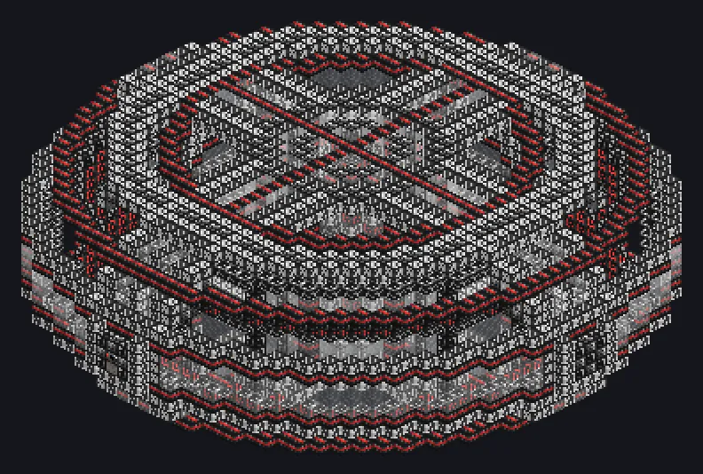

---
tags:
  - Sistemas de fim de jogo
---

# Campo de Contenção de Condensado de Bose-Einstein

<!-- Gerada a partir do código do mod; a estrutura mostrada é a menor variante. -->

*Fique parado. Bem parado.*

{ loading=lazy }

| | |
|---|---|
| **Tipo de máquina** | Armazenamento BEC |
| **Categoria** | Sistemas de fim de jogo |
| **Tipos de receita** | Nenhum |
| **Tamanho** | 45 × 17 × 45 |
| **Blocos** | 5.333 |
| **Origem** | GT: New Horizons |

## Descrição

Guarda condensado para a rede; ajuste a força do campo nos parâmetros.

- O condensado injetado se divide pela capacidade dos campos
- 1 de força guarda 1 mB e custa 1 EU/t
- Cheio demais: mantém 9/10 de cada condensado por segundo
- Destrói tudo se ficar sem energia ou for desligado

## Estrutura

| Bloco | Qtd. |
|---|---:|
| Guia de Ondas Eletromagnético | 1.236 |
| Conduto de Plasma Preservador de Coerência | 1.045 |
| Carcaça de Indução de Conflito | 896 |
| Carcaça de Imposição da Paz | 568 |
| Bobina Guia de Condensado | 508 |
| Manipulador da Constante de Estrutura Fina | 442 |
| Carcaça Eletromagneticamente Isolada | 343 |
| Bobina Transformadora de Condensado | 292 |
| Campo de Contenção de Condensado de Bose-Einstein | 1 |
| ULV Energy Hatch | 1 |
| Hatch de Condensado de Bose-Einstein | 1 |

<small>Gerada a partir do código do mod; a estrutura mostrada é a menor variante.</small>
