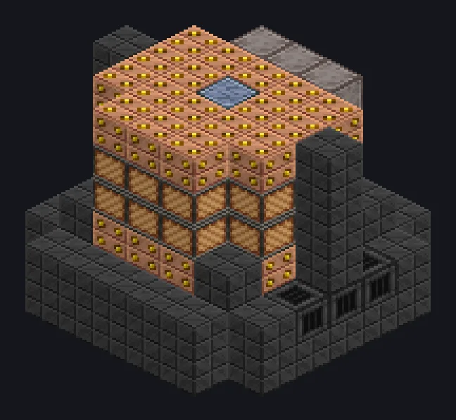

---
tags:
  - Catálogo de multiblocos
---

# Alto-Forno de Blaze

<!-- Página gerada a partir do código do mod; a estrutura é a menor variante. -->

{ loading=lazy }

| | |
|---|---|
| **Tipos de receita** | Electric Blast Furnace |
| **Tamanho** | 7 × 6 × 7 |
| **Blocos** | 150 |

## Descrição

Um estagiário deixou um spawner de blaze aqui dentro. Funcionou. Roda receitas do Alto-Forno Elétrico em lotes enormes, acelerado por Blaze derretido.

- Tipo de Máquina: Alto-Forno Elétrico
- Duração da receita 0,5x
- Paralelos: 64
- Blaze Líquido: 2^(tier-2) x 10 mB/s
- Consome Blaze Líquido quando cada receita começa

## Estrutura

| Bloco | Qtd. |
|---|---:|
| High Temperature Smelting Casing | 66 |
| Carcaça de Blaze | 37 |
| Cupronickel Coil Block | 24 |
| Tungstensteel Pipe Casing | 9 |
| Heat Vent | 6 |
| ULV Output Hatch | 1 |
| ULV Energy Hatch | 1 |
| ULV Input Bus | 1 |
| Alto-Forno de Blaze | 1 |
| ULV Output Bus | 1 |
| Muffler Hatch IV | 1 |
| Cleaning Maintenance Hatch | 1 |
| ULV Input Hatch | 1 |

<small>Página gerada a partir do código do mod; a estrutura é a menor variante.</small>
