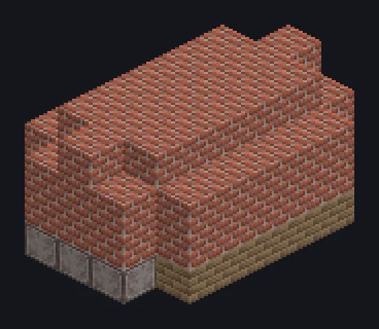

---
tags:
  - Catálogo de multiblocos
---

# Forno de Tijolos

<!-- Página gerada a partir do código do mod; a estrutura é a menor variante. -->

{ loading=lazy }

| | |
|---|---|
| **Tipos de receita** | Queima de Tijolos |
| **Tamanho** | 5 × 4 × 7 |
| **Blocos** | 88 |

## Descrição

Queima tijolos e cerâmicas a partir de argila compactada e carvão.

- Tipo de Máquina: Queima de Tijolos
- Tijolos: o bloco de construção original.
- Funciona sem hatch de energia

## Estrutura

| Bloco | Qtd. |
|---|---:|
| Bricks | 57 |
| Firebricks | 16 |
| Stone Bricks | 11 |
| ULV Input Hatch | 1 |
| Forno de Tijolos | 1 |
| ULV Output Bus | 1 |
| ULV Input Bus | 1 |

<small>Página gerada a partir do código do mod; a estrutura é a menor variante.</small>
