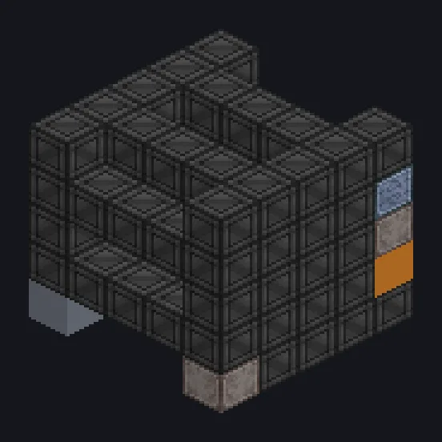

---
tags:
  - Processamento elétrico
---

# Fábrica Química

<!-- Gerada a partir do código do mod; a estrutura mostrada é a menor variante. -->

*O presidente posa com um microscópio. Ninguém cai nessa.*

{ loading=lazy }

| | |
|---|---|
| **Tipo de máquina** | Reator Químico Grande |
| **Categoria** | Processamento elétrico |
| **Tipos de receita** | Large Chemical Reactor |
| **Tamanho** | 5 × 5 × 5 |
| **Blocos** | 101 |
| **Origem** | GregTech Odyssey |

## Descrição

Roda receitas do Reator Químico Grande em massa com bobinas e um Parallel Hatch.

- Overclock perfeito: duração /4 por tier
- Cada tier de bobina acima de Cupronickel: -5% EU e tempo
- Paralelos definidos pelo Parallel Control Hatch

## Estrutura

| Bloco | Qtd. |
|---|---:|
| Chemically Inert PTFE Machine Casing | 66 |
| Cupronickel Coil Block | 15 |
| PTFE Pipe Casing | 12 |
| Cleaning Maintenance Hatch | 1 |
| ULV Output Bus | 1 |
| ULV Output Hatch | 1 |
| ULV Input Bus | 1 |
| ULV Energy Hatch | 1 |
| Fábrica Química | 1 |
| ULV Input Hatch | 1 |
| Elite Parallel Control Hatch | 1 |

<small>Gerada a partir do código do mod; a estrutura mostrada é a menor variante.</small>
