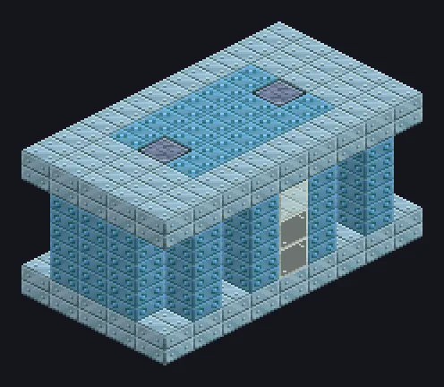

---
tags:
  - Multiblock catalog
---

# Cold Ice Freezer

<!-- Generated from the mod code; the structure shown is the smallest variant. -->

{ loading=lazy }

| | |
|---|---|
| **Recipe types** | Vacuum Freezer, Atomization Condensation |
| **Size** | 5 × 5 × 9 |
| **Blocks** | 174 |

## Description

Born from a liquid ice leak. The intern is still missing. Freezes Vacuum Freezer and Atomization recipes in huge batches with Liquid Ice.

- Machine Type: Vacuum Freezer
- 0.5x recipe duration
- Parallel: 64
- Liquid Ice: 2^(tier-2) x 10 mB/s
- Consumes Liquid Ice when each recipe starts

## Structure

| Block | Qty |
|---|---:|
| Frost Proof Aluminium Machine Casing | 75 |
| Cold Ice Casing | 48 |
| Aluminium Frame | 24 |
| Tungstensteel Pipe Casing | 12 |
| Tempered Glass | 6 |
| Muffler Hatch IV | 2 |
| ULV Energy Hatch | 1 |
| ULV Output Bus | 1 |
| ULV Output Hatch | 1 |
| Auto Maintenance Hatch | 1 |
| Cold Ice Freezer | 1 |
| ULV Input Bus | 1 |
| ULV Input Hatch | 1 |

<small>Generated from the mod code; the structure shown is the smallest variant.</small>
