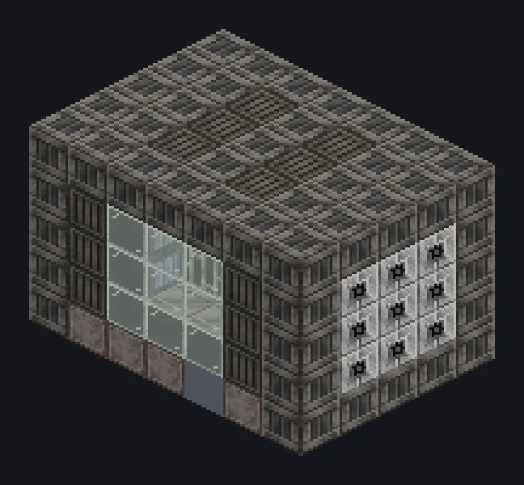

---
tags:
  - Electric processing
---

# Component Assembler

<!-- Generated from the mod code; the structure shown is the smallest variant. -->

*Your first salary won't cover one of its parts.*

{ loading=lazy }

| | |
|---|---|
| **Machine type** | Component Assembly |
| **Category** | Electric processing |
| **Recipe types** | Component Assembly |
| **Size** | 7 × 5 × 5 |
| **Blocks** | 152 |
| **Origin** | GregTech Odyssey |

## Description

Assembles batches of 16 electric components from materials and circuits.

- Extension: recipe cap IV -> UV + Accelerate
- Extension 2: Parallel Control and Laser Hatches
- Recipe cap: IV, never above the casing tier
- Each upgrade needs a bigger structure

## Structure

| Block | Qty |
|---|---:|
| Solid Machine Casing | 61 |
| LV Component Assembly Casing | 18 |
| Assembly Line Grating | 18 |
| Tempered Glass | 18 |
| Multi Functional Casing | 14 |
| Solid Steel Machine Casing | 9 |
| Iron Bars | 4 |
| Steel Frame | 2 |
| Steel Gearbox Casing | 2 |
| ULV Input Hatch | 1 |
| ULV Output Bus | 1 |
| Component Assembler | 1 |
| ULV Input Bus | 1 |
| Cleaning Maintenance Hatch | 1 |
| ULV Energy Hatch | 1 |

<small>Generated from the mod code; the structure shown is the smallest variant.</small>
