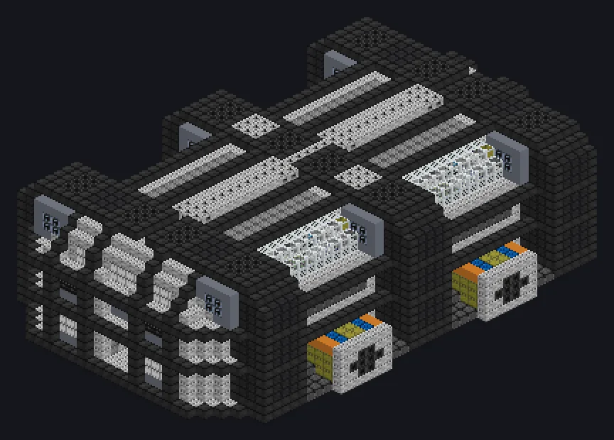

---
tags:
  - 电力加工
---

# 部件装配车间

<!-- 根据模组代码生成;所示结构为最小形态。 -->

*工业界最接近神造之物的存在。*

{ loading=lazy }

| | |
|---|---|
| **机器类型** | 部件装配 |
| **分类** | 电力加工 |
| **配方类型** | 部件装配 |
| **尺寸** | 31 × 15 × 47 |
| **方块数** | 10,699 |
| **来源** | GregTech Odyssey |

## 说明

以带并行仓的分级外壳生产线运行部件装配批次。

- 并行数由并行仓设定
- 外壳等级限制可启动的配方
- 所有装配外壳必须为同一等级

## 结构

| 方块 | 数量 |
|---|---:|
| 铱强化机械方块 | 3,184 |
| 硅岩合金机械外壳 | 1,376 |
| 绝缘机械方块 | 1,014 |
| 抗氧化哈斯特洛伊合金-N机械方块 | 862 |
| 精密加工机械方块 | 564 |
| 氮化钛陶瓷抗冲击机械方块 | 464 |
| 超净间玻璃 | 428 |
| 碳化硼抗辐射外壳 | 414 |
| 哈斯特洛依合金-N框架 | 364 |
| 耐化学腐蚀管道机械方块 | 262 |
| 压力容器机械方块 | 244 |
| 过滤器机械方块 | 208 |
| HSLA钢框架 | 200 |
| 聚四氟乙烯管道方块 | 178 |
| 氧化锆陶瓷高强度耐弯折机械方块 | 130 |
| 电路装配线机械外壳 | 116 |
| 密封机械方块 VI | 96 |
| 进阶装配线控制外壳 | 96 |
| 超能硅岩框架 | 90 |
| 极限引擎进气机械方块 | 80 |
| 装配线控制外壳 | 78 |
| 白色灯 | 65 |
| 分子机械方块 | 64 |
| LV 部件装配线外壳 | 63 |
| 超时空装配单元 | 33 |
| 电解器 | 20 |
| 超净维护仓 | 1 |
| ULV输出总线 | 1 |
| 部件装配车间 | 1 |
| ULV能源仓 | 1 |
| ULV输入总线 | 1 |
| ULV输入仓 | 1 |

<small>根据模组代码生成；所示结构为最小形态。</small>
