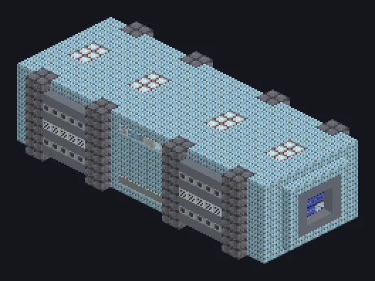

---
tags:
  - Electric processing
---

# Compound Extreme Cooling Unit

<!-- Generated from the mod code; the structure shown is the smallest variant. -->

*Freezes, atomizes and condenses plasma. Bring a coat.*

{ loading=lazy }

| | |
|---|---|
| **Machine type** | Vacuum Freezer |
| **Category** | Electric processing |
| **Recipe types** | Vacuum Freezer, Atomization Condensation, Plasma Condenser |
| **Size** | 31 × 9 × 13 |
| **Blocks** | 2,071 |
| **Origin** | GregTech Odyssey |

## Description

and plasma condensation.

- Three coolers in one: vacuum freezing, atomization
- Thread Hatch: several recipes at once
- Accepts Laser Hatches
- Builds in any direction
- Parallel set by the Parallel Hatch
- Plasma Condenser needs the larger plasma structure

## Structure

| Block | Qty |
|---|---:|
| Frost Proof Aluminium Machine Casing | 1,236 |
| Antifreeze Heatproof Machine Casing | 230 |
| Tungstensteel Pipe Casing | 208 |
| Neutronium Frame | 88 |
| High Power Casing | 80 |
| Hollow Casing | 56 |
| Amprosium Pipe Casing | 40 |
| Fusion Glass | 36 |
| Watertight Steel Frame | 32 |
| Filter Casing | 20 |
| Tempered Glass | 20 |
| Laser Casing | 10 |
| Laser Cooling Casing | 8 |
| ULV Energy Hatch | 1 |
| ULV Output Hatch | 1 |
| Cleaning Maintenance Hatch | 1 |
| ULV Input Bus | 1 |
| Compound Extreme Cooling Unit | 1 |
| ULV Output Bus | 1 |
| ULV Input Hatch | 1 |

<small>Generated from the mod code; the structure shown is the smallest variant.</small>
