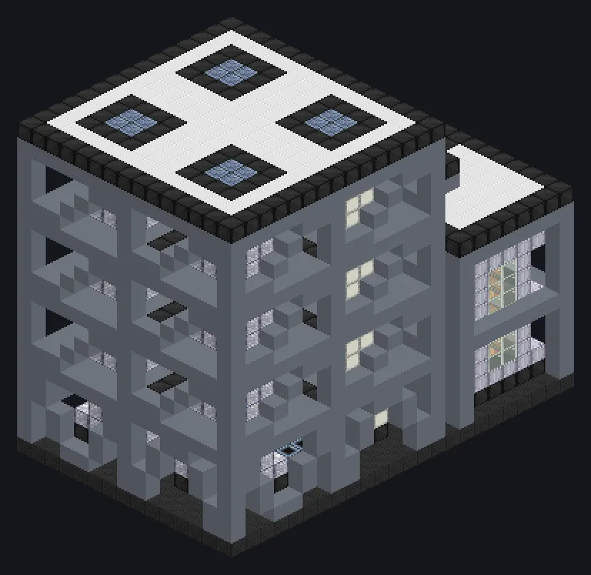

---
tags:
  - Processamento elétrico
---

# Central de Craqueamento

<!-- Gerada a partir do código do mod; a estrutura mostrada é a menor variante. -->

*Confira se as válvulas de segurança funcionam. Depois confira de novo.*

{ loading=lazy }

| | |
|---|---|
| **Tipo de máquina** | Craqueador, Forno de Pirólise |
| **Categoria** | Processamento elétrico |
| **Tipos de receita** | Cracker, Pyrolyse Oven |
| **Tamanho** | 15 × 23 × 25 |
| **Blocos** | 3.562 |
| **Origem** | GregTech Odyssey |

## Descrição

Seis colunas de reação que craqueiam e pirolisam moléculas complexas lado a lado.

- Paralelos 2x a cada 900K de bobina
- Thread Hatch: várias receitas ao mesmo tempo
- Usa o limite do Parallel Hatch se for maior

## Estrutura

| Bloco | Qtd. |
|---|---:|
| Ultimet Frame | 403 |
| Invólucro de Liga de Naquadah | 383 |
| Bloco de Base Reforçada | 360 |
| Hastelloy C-276 Frame | 359 |
| Clean Stainless Steel Casing | 294 |
| Stainless Steel Frame | 286 |
| Bloco Mecânico Anticorrosão de Cerâmica de Óxido de Cálcio | 286 |
| Carcaça de Contenção de Pressão | 286 |
| Tungstensteel Pipe Casing | 280 |
| Carcaça Mecânica de Plástico ABS Branca | 159 |
| Cupronickel Coil Block | 120 |
| Tempered Glass | 96 |
| Assembly Line Grating | 92 |
| Carcaça de Tubo de Alta Pressão | 84 |
| Carcaça de Tubulação Selada de Óleo e Gás | 51 |
| Muffler Hatch IV | 16 |
| ULV Energy Hatch | 1 |
| ULV Output Hatch | 1 |
| Cleaning Maintenance Hatch | 1 |
| ULV Input Bus | 1 |
| Central de Craqueamento | 1 |
| ULV Output Bus | 1 |
| ULV Input Hatch | 1 |

<small>Gerada a partir do código do mod; a estrutura mostrada é a menor variante.</small>
