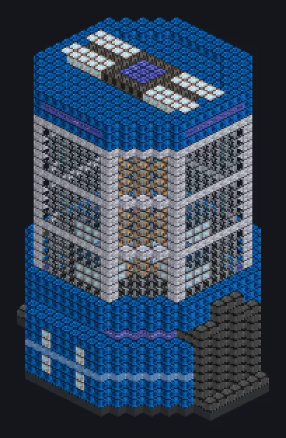

---
tags:
  - Catálogo de multiblocos
---

# Construtor de Cristais

<!-- Página gerada a partir do código do mod; a estrutura é a menor variante. -->

{ loading=lazy }

| | |
|---|---|
| **Tipos de receita** | Autoclave |
| **Tamanho** | 23 × 34 × 21 |
| **Blocos** | 4.809 |

## Descrição

A fábrica dos sonhos dos Bragg, uma rede perfeita por vez. Cultiva cristais sem defeitos sob pressão altíssima.

- Tipo de Máquina: Autoclave
- Paralelos 2x a cada 900K de bobina
- Thread Hatch: várias receitas ao mesmo tempo
- Usa o limite do Parallel Hatch se for maior

## Estrutura

| Bloco | Qtd. |
|---|---:|
| Carcaça Molecular | 1.464 |
| Fusion Glass | 896 |
| High Power Casing | 749 |
| Carcaça de Contenção de Pressão | 388 |
| Concreto de Alta Resistência | 332 |
| Carcaça de Planta Reforçada com Naquadah | 180 |
| Cupronickel Coil Block | 176 |
| Carcaça de Laser | 173 |
| Nonconducting Casing | 134 |
| Vidro Quântico | 88 |
| Hipernúcleo | 61 |
| Carcaça de Máquina de Pikyônio | 52 |
| Electrolytic Cell | 44 |
| Gerador de Campo de Contenção | 32 |
| Assembly Line Grating | 24 |
| Bobina Molecular | 9 |
| ULV Energy Hatch | 1 |
| ULV Output Bus | 1 |
| ULV Output Hatch | 1 |
| Auto Maintenance Hatch | 1 |
| Construtor de Cristais | 1 |
| ULV Input Bus | 1 |
| ULV Input Hatch | 1 |

<small>Página gerada a partir do código do mod; a estrutura é a menor variante.</small>
