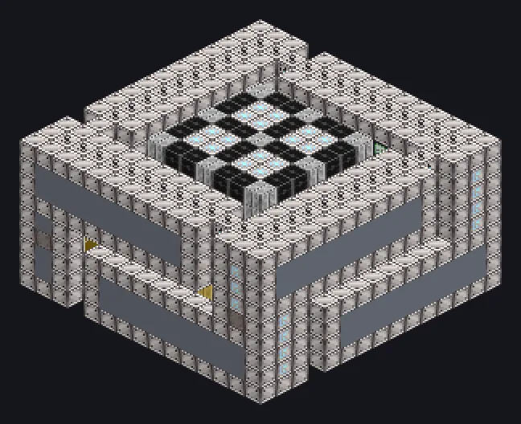

---
tags:
  - Multiblock catalog
---

# Data Center

<!-- Generated from the mod code; the structure shown is the smallest variant. -->

{ loading=lazy }

| | |
|---|---|
| **Recipe types** | None |
| **Size** | 15 × 9 × 15 |
| **Blocks** | 1,583 |

## Description

Every research note, cooled by NICH and served at the speed of light. A large Data Bank that shares research data with Assembly Lines over optical cables.

- Machine Type: Data Bank
- Many Optical Data Hatches
- Chains with other Data Banks
- Up to 16 transmission and 4 reception hatches
- Data/Optical Hatches: 1,920 EU/t each normally
- Needs NICH Cooling Components in its walls
- With optical reception: 30,720 EU/t per data hatch

## Structure

| Block | Qty |
|---|---:|
| Computer Casing | 438 |
| Advanced Computer Casing | 222 |
| Iridium Casing | 151 |
| Basic Data Access Hatch | 144 |
| Cobalt Oxide Ceramic Strong Thermally Conductive Mechanical Block | 142 |
| High Power Casing | 122 |
| NICH Cooling Components | 112 |
| Naquadria Frame | 98 |
| Electron Permeable Amprosium Coated Glass | 60 |
| Chemical Corrosion Resistant Pipe Casing | 48 |
| Electrolytic Cell | 24 |
| Iridium Pipe Casing | 16 |
| ULV Energy Hatch | 2 |
| Optical Data Transmission Hatch | 1 |
| Optical Data Reception Hatch | 1 |
| Cleaning Maintenance Hatch | 1 |
| Data Center | 1 |

<small>Generated from the mod code; the structure shown is the smallest variant.</small>
