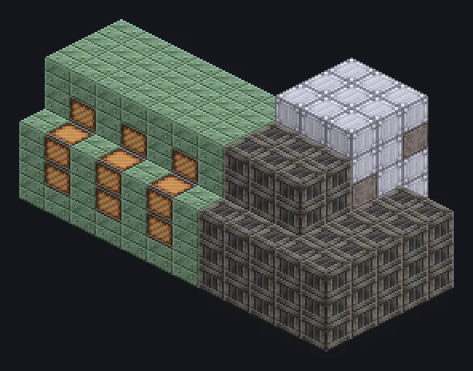

---
tags:
  - Multiblock catalog
---

# Desulfurizer

<!-- Generated from the mod code; the structure shown is the smallest variant. -->

{ loading=lazy }

| | |
|---|---|
| **Recipe types** | Desulfurizer |
| **Size** | 12 × 6 × 6 |
| **Blocks** | 270 |

## Description

Sulfur out, clean fuel in. The air says thanks. Strips sulfur from sulfuric fuels and gases, leaving them ready for refining.

- Machine Type: Desulfurizer
- Optional extension unlocks Thread, Overclock,
- Accelerate, Parallel and Laser Hatches
- Parallel 2x for each 900K of coil temperature
- Uses the Parallel Hatch limit if higher
- The extension needs a Muffler Hatch

## Structure

| Block | Qty |
|---|---:|
| Heat Proof Invar Machine Casing | 99 |
| Solid Machine Casing | 76 |
| Cupronickel Coil Block | 30 |
| Clean Stainless Steel Casing | 28 |
| Steel Pipe Casing | 20 |
| Hermetic Casing II | 6 |
| Bronze Pipe Casing | 5 |
| ULV Output Bus | 1 |
| Desulfurizer | 1 |
| Auto Maintenance Hatch | 1 |
| ULV Output Hatch | 1 |
| ULV Energy Hatch | 1 |
| ULV Input Hatch | 1 |

<small>Generated from the mod code; the structure shown is the smallest variant.</small>
