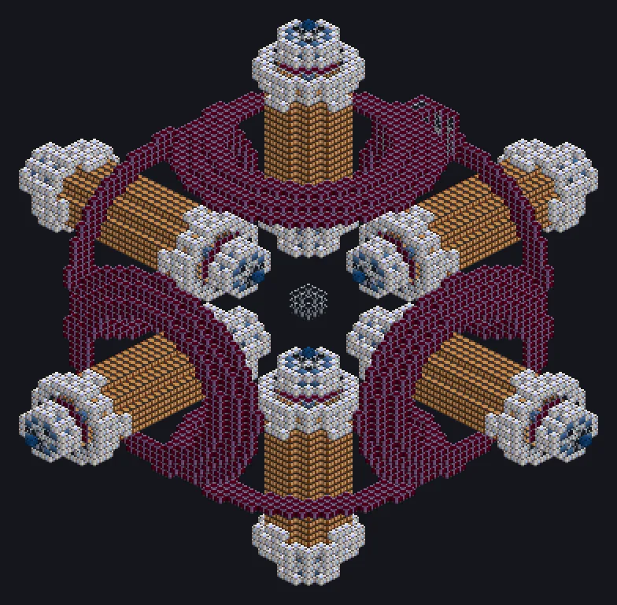

---
tags:
  - Multiblock catalog
---

# Dimensional Focus Engraving Array

<!-- Generated from the mod code; the structure shown is the smallest variant. -->

{ loading=lazy }

| | |
|---|---|
| **Recipe types** | Dimensional Focus Engraving Array |
| **Size** | 89 × 89 × 89 |
| **Blocks** | 10,054 |

## Description

Focuses a laser through a fold in space. Precision, now in 4D. Engraves with dimensionally focused lasers for endgame wafers and chips.

- Machine Type: Engraver
- Thread Hatch: several recipes at once
- Accepts Laser Hatches
- Parallel 2x for each 900K of coil temperature
- Uses the Parallel Hatch limit if higher

## Structure

| Block | Qty |
|---|---:|
| Cupronickel Coil Block | 3,312 |
| Laser-Safe Engraving Casing | 3,193 |
| Dimension Injection Casing | 1,821 |
| Fusion Glass | 976 |
| Molecular Coil | 462 |
| Improved Superconductor Coil | 144 |
| Containment Field Generator | 96 |
| Dimensionally Transcendent Casing | 43 |
| ULV Energy Hatch | 1 |
| Auto Maintenance Hatch | 1 |
| ULV Input Bus | 1 |
| ULV Output Bus | 1 |
| ULV Input Hatch | 1 |
| ULV Output Hatch | 1 |
| Dimensional Focus Engraving Array | 1 |

<small>Generated from the mod code; the structure shown is the smallest variant.</small>
