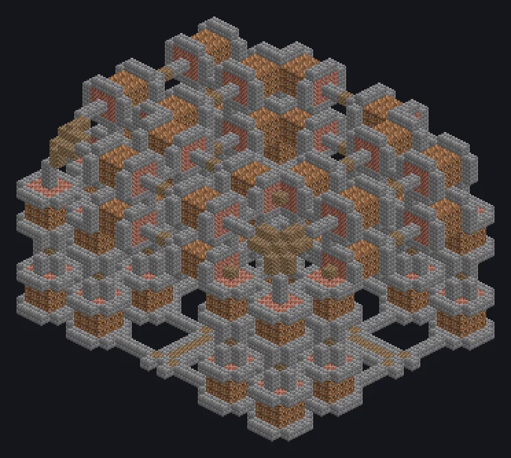

---
tags:
  - Multiblock catalog
---

# Dimensionally Transcendent Dirt Forge

<!-- Generated from the mod code; the structure shown is the smallest variant. -->

{ loading=lazy }

| | |
|---|---|
| **Recipe types** | Primitive Blast Furnace |
| **Size** | 33 × 24 × 27 |
| **Blocks** | 4,413 |

## Description

An absurd primitive forge shell repurposed for massive primitive blast throughput.

- Machine Type: Primitive Blast Furnace
- Someone looked at the DTPF and thought: what if dirt?
- Every recipe finishes in 1 tick
- Parallel: up to 524,288

## Structure

| Block | Qty |
|---|---:|
| Stone Bricks | 1,691 |
| Dirt | 1,608 |
| Bricks | 972 |
| Firebricks | 141 |
| Dimensionally Transcendent Dirt Forge | 1 |

<small>Generated from the mod code; the structure shown is the smallest variant.</small>
