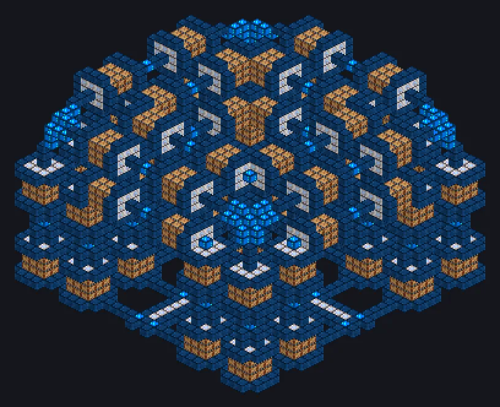

---
tags:
  - 终局系统
---

# 超维度熔炼

<!-- 根据模组代码生成;所示结构为最小形态。 -->

*自2015年起超越维度边界。*

{ loading=lazy }

| | |
|---|---|
| **机器类型** | 等离子锻炉、DTPF |
| **分类** | 终局系统 |
| **配方类型** | 等离子锻炉 |
| **尺寸** | 33 × 24 × 33 |
| **方块数** | 5,627 |
| **来源** | GT: New Horizons |

## 说明

一座逐渐突破维度边界的锻炉，运行越久燃料消耗越少。

- 运行8小时后燃料最多减少50%
- 至少1,250个维度注入外壳
- 最多2个能源仓或1个激光仓
- 空闲时：折扣衰减快100倍

## 结构

| 方块 | 数量 |
|---|---:|
| 超维度机械方块 | 2,121 |
| 白铜线圈方块 | 2,112 |
| 维度注入机械方块 | 1,268 |
| 维度桥接方块 | 120 |
| ULV输出总线 | 1 |
| ULV输入总线 | 1 |
| 超维度熔炼 | 1 |
| ULV输出仓 | 1 |
| ULV输入仓 | 1 |
| ULV能源仓 | 1 |

<small>根据模组代码生成；所示结构为最小形态。</small>
