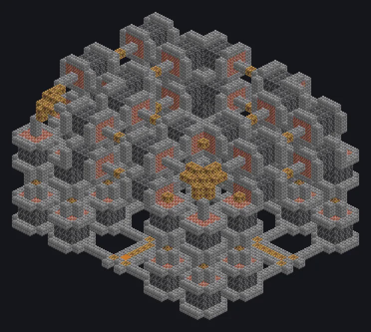

---
tags:
  - Steam and primitive
---

# Dimensionally Transcendent Steam Oven

<!-- Generated from the mod code; the structure shown is the smallest variant. -->

*Preheat to 350 degrees. Then add infinity.*

{ loading=lazy }

| | |
|---|---|
| **Machine type** | Furnace |
| **Category** | Steam and primitive |
| **Recipe types** | Electric Furnace |
| **Size** | 33 × 24 × 27 |
| **Blocks** | 4,413 |
| **Origin** | GregTech Leisure |

## Description

A steam oven pushed far beyond sane thermal engineering limits.

- 100x speed vs. a furnace
- 2 threads: two furnace recipes at once
- Parallel: up to 524,288

## Structure

| Block | Qty |
|---|---:|
| Stone Bricks | 1,691 |
| Deepslate | 1,608 |
| Bricks | 972 |
| Steam Machine Casing | 140 |
| Wireless Steam Input Hatch | 1 |
| Dimensionally Transcendent Steam Oven | 1 |

<small>Generated from the mod code; the structure shown is the smallest variant.</small>
