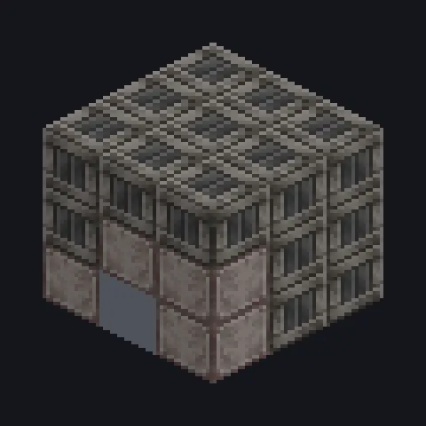

---
tags:
  - Multiblock catalog
---

# Duration Tester

<!-- Generated from the mod code; the structure shown is the smallest variant. -->

{ loading=lazy }

| | |
|---|---|
| **Recipe types** | Assembler, Circuit Assembler |
| **Size** | 3 × 3 × 3 |
| **Blocks** | 26 |

## Description

If you are reading this, you found the dev room. A test machine for Duration and Accelerate Hatches; not meant for survival.

- Machine Type: Developer Tool
- Runs Assembler and Circuit Assembler recipes
- Accepts Thread and Overclock Hatches
- Development use only

## Structure

| Block | Qty |
|---|---:|
| Solid Machine Casing | 20 |
| ULV Input Bus | 1 |
| Cleaning Maintenance Hatch | 1 |
| Duration Tester | 1 |
| ULV Input Hatch | 1 |
| ULV Energy Hatch | 1 |
| ULV Output Bus | 1 |

<small>Generated from the mod code; the structure shown is the smallest variant.</small>
