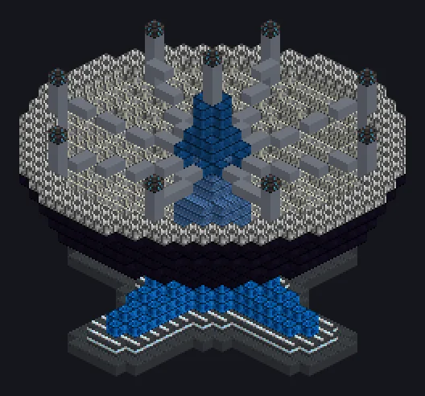

---
tags:
  - Catálogo de multiblocos
---

# Estação Receptora da Esfera de Dyson

<!-- Página gerada a partir do código do mod; a estrutura é a menor variante. -->

{ loading=lazy }

| | |
|---|---|
| **Tipos de receita** | Nenhum |
| **Tamanho** | 29 × 26 × 29 |
| **Blocos** | 2.806 |
| **Gerador** | ✓ |

## Descrição

Toda essa luz do sol ia ser desperdiçada mesmo. Coleta a energia do enxame de Dyson do planeta e a envia como laser.

- Tipo de Máquina: Gerador
- A saída cresce com os módulos em órbita
- Precisa de computação e hélio líquido
- Um enxame muito danificado rende menos
- Cada ciclo pode danificar o enxame

## Estrutura

| Bloco | Qtd. |
|---|---:|
| Carcaça Mecânica Hyper Reforçada | 695 |
| Carcaça Absorvedora de Radiação | 684 |
| Concreto de Alta Resistência | 305 |
| Estrutura de Suporte Interno do Elevador Espacial | 287 |
| Carcaça Molecular | 220 |
| Toroide de Controle Dyson | 148 |
| Bobina Molecular | 135 |
| Naquadah Alloy Frame | 126 |
| Estrutura de Suporte do Elevador Espacial | 95 |
| Invólucro Dimensionalmente Transcendente | 40 |
| High Power Casing | 37 |
| Invólucro Receptor Dyson | 21 |
| Hipernúcleo | 9 |
| Computation Data Reception Hatch | 1 |
| Estação Receptora da Esfera de Dyson | 1 |
| ULV Input Hatch | 1 |
| IV 4,096A Laser Source Hatch | 1 |

<small>Página gerada a partir do código do mod; a estrutura é a menor variante.</small>
