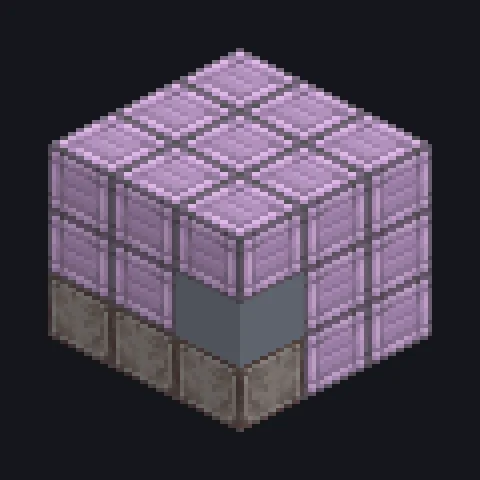

---
tags:
  - Processamento elétrico
---

# Minerador do Vazio Elétrico

<!-- Gerada a partir do código do mod; a estrutura mostrada é a menor variante. -->

*Minerando o nada e recebendo tudo. A física é opcional.*

{ loading=lazy }

| | |
|---|---|
| **Tipo de máquina** | Mineração do Vazio |
| **Categoria** | Processamento elétrico |
| **Tipos de receita** | Mineração Precisa do Vazio, Mineração Aleatória do Vazio |
| **Tamanho** | 3 × 3 × 3 |
| **Blocos** | 27 |
| **Origem** | GregTech Leisure |

## Descrição

Minera programas de veio de Minérios Brutos usando energia e Fluido de Perfuração.

- Modo preciso: escolha o veio com uma essência
- Modo aleatório: sem essência, pool ZPM completo
- Circuito 1 = básicos EV, circuito 2 = veios LuV/ZPM
- A partir do IV, um Parallel Control Hatch dá paralelos
- Precisa de Fluido de Perfuração em toda operação
- O tier EV não tem paralelos

## Estrutura

| Bloco | Qtd. |
|---|---:|
| Stable Titanium Machine Casing | 21 |
| ULV Input Hatch | 1 |
| ULV Output Bus | 1 |
| Minerador do Vazio Elétrico | 1 |
| Titanium Frame | 1 |
| ULV Energy Hatch | 1 |
| Cleaning Maintenance Hatch | 1 |

<small>Gerada a partir do código do mod; a estrutura mostrada é a menor variante.</small>
