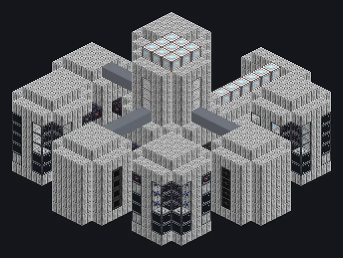

---
tags:
  - Multiblock catalog
---

# Engraving Laser Plant

<!-- Generated from the mod code; the structure shown is the smallest variant. -->

{ loading=lazy }

| | |
|---|---|
| **Recipe types** | Laser Engraver, Precision Laser Engraving |
| **Size** | 21 × 12 × 22 |
| **Blocks** | 1,521 |

## Description

Precise enough to engrave QR codes on viruses. Why? Unknown. A photon engraving plant that runs Laser Engraver and Precision Laser recipes.

- Machine Type: Laser Engraver, Precision
- Perfect overclock: duration /4 per tier
- Laser Engraver: Parallel Control Hatch
- Precision Laser Engraving: parallel 1

## Structure

| Block | Qty |
|---|---:|
| Iridium Casing | 810 |
| High Power Casing | 175 |
| Fusion Glass | 160 |
| Amprosium Gearbox | 121 |
| Hermetic Casing IX | 49 |
| Optical Resonance Chamber | 49 |
| Neutronium Frame | 36 |
| Sterilizing Filter Casing | 33 |
| UV Component Assembly Line Casing | 29 |
| Molecular Casing | 20 |
| Electrolytic Cell | 17 |
| Advanced Compressed Fusion Coil | 8 |
| Heat Vent | 8 |
| ULV Energy Hatch | 1 |
| Cleaning Maintenance Hatch | 1 |
| ULV Input Bus | 1 |
| ULV Input Hatch | 1 |
| Engraving Laser Plant | 1 |
| ULV Output Bus | 1 |

<small>Generated from the mod code; the structure shown is the smallest variant.</small>
