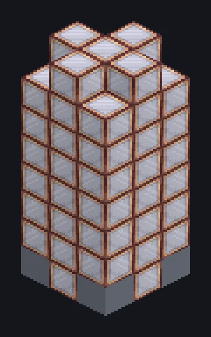

---
tags:
  - Multiblock catalog
---

# Evaporation Plant

<!-- Generated from the mod code; the structure shown is the smallest variant. -->

{ loading=lazy }

| | |
|---|---|
| **Recipe types** | Evaporation |
| **Size** | 3 × 8 × 3 |
| **Blocks** | 62 |

## Description

Patience, salt and a very tall tower. Evaporates brine and other fluids in a tall tower with up to five stages.

- Machine Type: Evaporation
- Accepts Parallel and Accelerate Hatches
- Up to 5 tower stages, one fluid output each
- An IV Parallel Hatch gives 4 parallel

## Structure

| Block | Qty |
|---|---:|
| Stainless Evaporation Casing | 55 |
| Aluminium Frame | 4 |
| ULV Input Hatch | 1 |
| ULV Energy Hatch | 1 |
| Evaporation Plant | 1 |

<small>Generated from the mod code; the structure shown is the smallest variant.</small>
