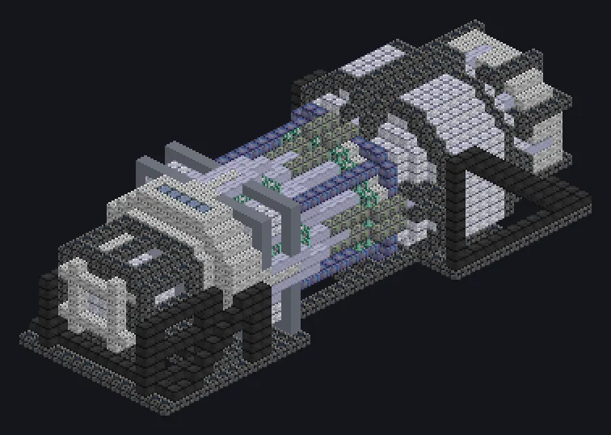

---
tags:
  - Multiblock catalog
---

# Extreme Compressor

<!-- Generated from the mod code; the structure shown is the smallest variant. -->

{ loading=lazy }

| | |
|---|---|
| **Recipe types** | Compressor |
| **Size** | 17 × 16 × 43 |
| **Blocks** | 4,304 |

## Description

Megaton press. Even the hardest metal learns manners. A planetary-grade hydraulic system that squeezes ingots, dust and plates into denser forms.

- Machine Type: Compressor
- Thread Hatch: several recipes at once
- Accepts Laser Hatches
- Parallel set by the Parallel Hatch
- Needs a Muffler Hatch

## Structure

| Block | Qty |
|---|---:|
| Pressure Containment Casing | 879 |
| Iridium Casing | 724 |
| Stress Proof Casing | 718 |
| High Pressure Resistant Casing | 663 |
| Naquadah Alloy Casing | 252 |
| Incoloy Ma 956 Frame | 232 |
| Inconel-625 Pipe | 165 |
| Iridium Gearbox | 148 |
| Iridium Pipe Casing | 145 |
| Tungstensteel Pipe Casing | 100 |
| High Pressure Pipe Casing | 86 |
| Tungsten Steel Frame | 72 |
| Chemical Corrosion Resistant Pipe Casing | 64 |
| Hermetic Casing VIII | 36 |
| High Strength Support Spindle | 10 |
| Muffler Hatch IV | 5 |
| ULV Output Bus | 1 |
| ULV Input Bus | 1 |
| Extreme Compressor | 1 |
| Cleaning Maintenance Hatch | 1 |
| ULV Energy Hatch | 1 |

<small>Generated from the mod code; the structure shown is the smallest variant.</small>
