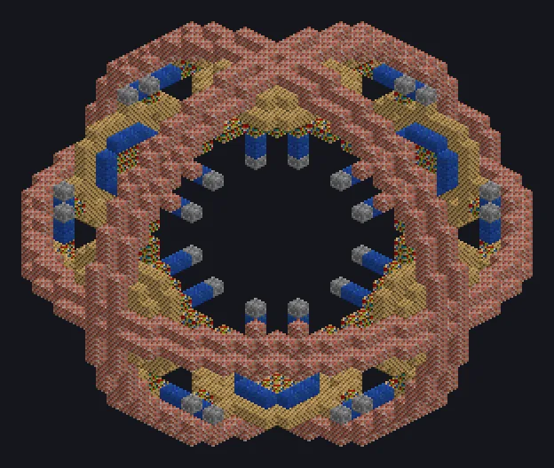

---
tags:
  - Steam and primitive
---

# Eye of Wood

<!-- Generated from the mod code; the structure shown is the smallest variant. -->

*The Eye of Harmony's rustic cousin from the countryside.*

{ loading=lazy }

| | |
|---|---|
| **Machine type** | Ore Condenser |
| **Category** | Steam and primitive |
| **Recipe types** | None |
| **Size** | 33 × 33 × 33 |
| **Blocks** | 1,821 |
| **Origin** | Twist Space Technology |

## Description

An Overworld-only ore condenser that stores Water and Lava and turns them into large ore bundles.

- Peak success: 75% at 256,000 mB of each fluid
- Each run takes a fixed 60 s
- Failure vents up to 270,000,000 mB Steam
- Overworld only
- Both shortage and excess of water/lava lower the chance

## Structure

| Block | Qty |
|---|---:|
| Bricks | 896 |
| Oak Planks | 534 |
| Block of Lapis Lazuli | 168 |
| Bookshelf | 138 |
| Cracked Stone Bricks | 48 |
| Steam Machine Casing | 36 |
| Eye of Wood | 1 |

<small>Generated from the mod code; the structure shown is the smallest variant.</small>
