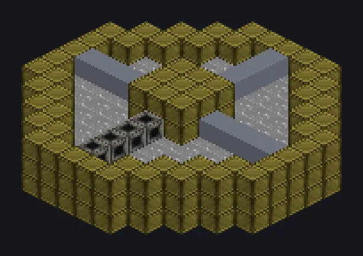

---
tags:
  - 电力加工
---

# 渔场

<!-- 根据模组代码生成;所示结构为最小形态。 -->

*喜欢吃鱼吗？现在整个办公室都喜欢了。*

{ loading=lazy }

| | |
|---|---|
| **机器类型** | 渔场 |
| **分类** | 电力加工 |
| **配方类型** | 渔场 |
| **尺寸** | 13 × 4 × 13 |
| **方块数** | 340 |
| **来源** | GregTech Odyssey |

## 说明

结构中用鱼饵自动钓鱼。

- AFFL-200智能渔场：在充满水的
- 电路选择渔获类型
- 电路1随机，2鱼，3垃圾，4宝藏
- 钓鱼需要鱼饵

## 结构

| 方块 | 数量 |
|---|---:|
| 铝青铜机械方块 | 221 |
| Water | 88 |
| 不锈钢框架 | 19 |
| 钢管道方块 | 7 |
| ULV能源仓 | 1 |
| 超净维护仓 | 1 |
| ULV输入总线 | 1 |
| 渔场 | 1 |
| ULV输出总线 | 1 |

<small>根据模组代码生成；所示结构为最小形态。</small>
