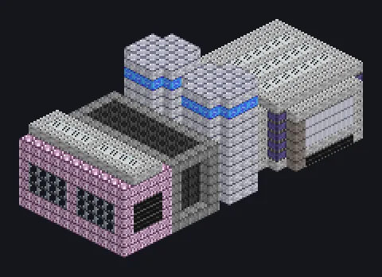

---
tags:
  - 发电
---

# 燃料电池发电机

<!-- 根据模组代码生成;所示结构为最小形态。 -->

*一块会喝燃料、还记得自己有多累的电池。*

{ loading=lazy }

| | |
|---|---|
| **机器类型** | 燃料电池 |
| **分类** | 发电 |
| **配方类型** | 燃料电池液能量吸收，燃料电池液能量交换，燃料电池液能量释放 |
| **尺寸** | 11 × 11 × 27 |
| **方块数** | 1,567 |
| **来源** | GregTech Odyssey |

## 说明

用燃料为氧化还原液流电解液充电，在它们之间转移电荷并以EU放电。

- 三种模式：吸收、传输、释放
- 更好的膜电极提高效率
- 释放：最高50并行
- 空闲恢复：600 mB/t蒸馏水
- 每刻恢复15%的损失效率
- 传输会交换输入的充电状态
- 每次释放运行有0.35%的几率消耗膜
- 吸收需要等量的阳极液和阴极液
- 能量传输按配方损失效率
- 吸收效率每次运行按膜衰减

## 结构

| 方块 | 数量 |
|---|---:|
| 压力容器机械方块 | 372 |
| 镀钯变电站机械方块 | 240 |
| 铱强化机械方块 | 210 |
| 聚四氟乙烯化学惰性机械方块 | 150 |
| 抗氧化哈斯特洛伊合金-N机械方块 | 86 |
| 铱管道方块 | 72 |
| 高速钢-G框架 | 60 |
| 光滑无菌絮凝机械方块 | 56 |
| 二硅化钼线圈方块 | 56 |
| 空电容（Tier II） | 54 |
| 氧化钙陶瓷抗金属侵蚀机械方块 | 49 |
| 电解器 | 38 |
| 耐化学腐蚀管道机械方块 | 36 |
| 过滤器机械方块 | 29 |
| 氧化钴陶瓷坚固导热机械方块 | 24 |
| 聚变玻璃 | 24 |
| ULV输入仓 | 4 |
| ULV输出仓 | 2 |
| ULV能源仓 | 1 |
| ULV输出总线 | 1 |
| 燃料电池发电机 | 1 |
| ULV动力仓 | 1 |
| ULV输入总线 | 1 |

<small>根据模组代码生成；所示结构为最小形态。</small>
