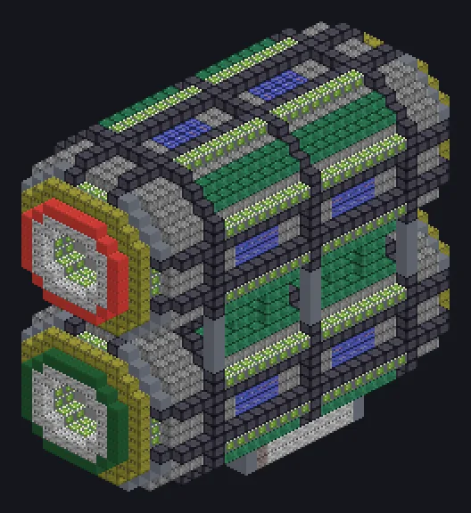

---
tags:
  - 电力加工
---

# 双子星封装系统

<!-- 根据模组代码生成;所示结构为最小形态。 -->

*同时打包和拆包。泡利会认可的。*

{ loading=lazy }

| | |
|---|---|
| **机器类型** | 打包机 |
| **分类** | 电力加工 |
| **配方类型** | 打包机 |
| **尺寸** | 15 × 29 × 32 |
| **方块数** | 6,875 |
| **来源** | GregTech Odyssey |

## 说明

一对包装生产线，像镜像电荷一样封装与拆封物品。

- 线程仓：同时运行多个配方
- 接受激光仓
- 线圈温度每900K并行翻倍
- 若并行仓上限更高则使用该上限

## 结构

| 方块 | 数量 |
|---|---:|
| 抗氧化哈斯特洛伊合金-N机械方块 | 2,368 |
| 工业无框玻璃 | 1,004 |
| PEEK耐磨机械外壳 | 609 |
| 工程机械方块 | 560 |
| 铱强化机械方块 | 430 |
| 白铜线圈方块 | 424 |
| 防震机械方块 | 296 |
| 激光机械方块 | 192 |
| 氮化钛陶瓷抗冲击机械方块 | 160 |
| 白色灯 | 144 |
| 黑钢框架 | 131 |
| 遏制场发生器 | 96 |
| 安普洛齿轮箱机械方块 | 88 |
| 因科镍625齿轮箱 | 88 |
| 绿色ABS塑料机械外壳 | 48 |
| 红色ABS塑料机械外壳 | 48 |
| 电路装配线机械外壳 | 46 |
| 钛齿轮箱机械方块 | 46 |
| 进阶装配线控制外壳 | 46 |
| 钨钢齿轮箱机械方块 | 46 |
| 超净维护仓 | 1 |
| ULV输出总线 | 1 |
| 双子星封装系统 | 1 |
| ULV能源仓 | 1 |
| ULV输入总线 | 1 |

<small>根据模组代码生成；所示结构为最小形态。</small>
