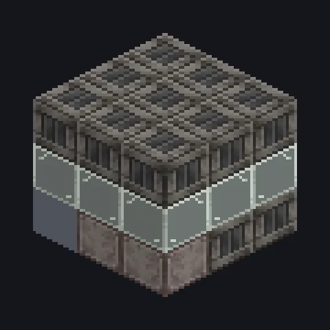

---
tags:
  - Geração de energia
---

# Matriz de Geradores

<!-- Gerada a partir do código do mod; a estrutura mostrada é a menor variante. -->

*Quatro geradores entram num bar. Uma conta só.*

{ loading=lazy }

| | |
|---|---|
| **Tipo de máquina** | Matriz de Geradores |
| **Categoria** | Geração de energia |
| **Tipos de receita** | Steam Turbine, Gas Turbine, Combustion Generator |
| **Tamanho** | 3 × 3 × 3 |
| **Blocos** | 26 |
| **Origem** | GregTech Odyssey |

## Descrição

Roda até quatro geradores iguais do GTCEu com as receitas normais de combustível.

- Produção 1,3x por gerador instalado
- Saída wireless para a Flux Matrix do dono
- Até 4 geradores do mesmo tipo e tier
- Steam Turbine, Gas Turbine, Combustion Gen.
- O consumo de combustível cresce com a produção
- A saída wireless perde 5%

## Estrutura

| Bloco | Qtd. |
|---|---:|
| Solid Machine Casing | 14 |
| Tempered Glass | 8 |
| Cleaning Maintenance Hatch | 1 |
| Matriz de Geradores | 1 |
| ULV Dynamo Hatch | 1 |
| ULV Input Bus | 1 |

<small>Gerada a partir do código do mod; a estrutura mostrada é a menor variante.</small>
