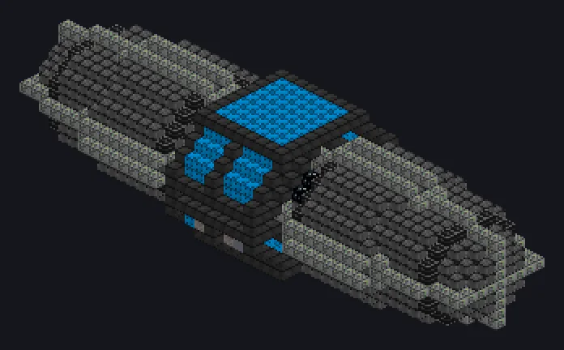

---
tags:
  - Electric processing
---

# Giant Electrochemical Workstation

<!-- Generated from the mod code; the structure shown is the smallest variant. -->

*Enough current to split water, salt and your patience.*

{ loading=lazy }

| | |
|---|---|
| **Machine type** | Electrolyzer |
| **Category** | Electric processing |
| **Recipe types** | Electrolyzer |
| **Size** | 45 × 13 × 15 |
| **Blocks** | 3,430 |
| **Origin** | GregTech Odyssey |

## Description

A giant electrolysis hall with heated cells and corrosion-proof piping.

- Thread Hatch: several recipes at once
- Accepts Laser Hatches
- Builds in any direction
- Parallel 2x for each 900K of coil temperature
- Uses the Parallel Hatch limit if higher

## Structure

| Block | Qty |
|---|---:|
| Nonconducting Casing | 1,240 |
| Space Elevator Mechanical Casing | 445 |
| Chemical Corrosion Resistant Pipe Casing | 338 |
| Calcium Oxide Ceramic Anti Metal Corrosion Mechanical Block | 240 |
| PTFE Pipe Casing | 230 |
| Hyper Mechanical Casing | 200 |
| Polytetrafluoroethylene Frame | 160 |
| Iridium Pipe Casing | 138 |
| Electrolytic Cell | 112 |
| Hermetic Casing IX | 96 |
| Cupronickel Coil Block | 80 |
| Neutronium Stable Casing | 64 |
| Hastelloy N Frame | 60 |
| Fusion Glass | 20 |
| ULV Output Hatch | 1 |
| ULV Input Hatch | 1 |
| ULV Output Bus | 1 |
| Giant Electrochemical Workstation | 1 |
| ULV Input Bus | 1 |
| Cleaning Maintenance Hatch | 1 |
| ULV Energy Hatch | 1 |

<small>Generated from the mod code; the structure shown is the smallest variant.</small>
