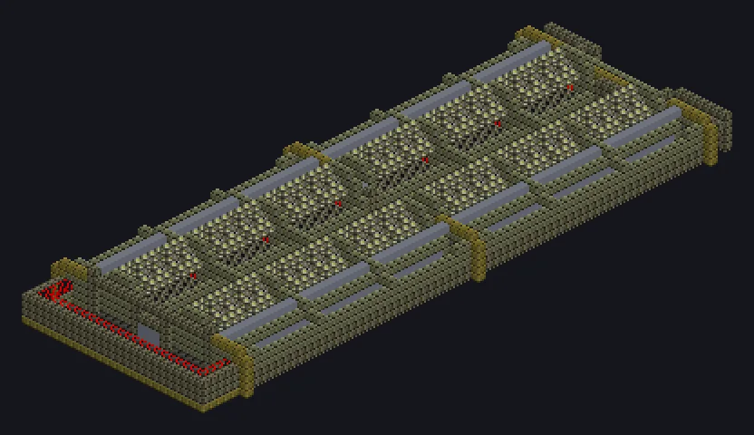

---
tags:
  - Multiblock catalog
---

# Giant Flotation Tank

<!-- Generated from the mod code; the structure shown is the smallest variant. -->

{ loading=lazy }

| | |
|---|---|
| **Recipe types** | Flotating Beneficiation |
| **Size** | 27 × 8 × 74 |
| **Blocks** | 6,625 |

## Description

Billions of bubbles, each one a tiny elevator for ore. A mineral flotation sanctuary that sorts ore particles with bubbles at megafactory scale.

- Machine Type: Flotating Beneficiation
- Thread Hatch: several recipes at once
- Accepts Laser Hatches
- Parallel set by the Parallel Hatch

## Structure

| Block | Qty |
|---|---:|
| Corrosion Proof Casing | 1,644 |
| Hastelloy N 75 Casing | 1,627 |
| Stabilized Naquadah Water Plant Casing | 924 |
| Calcium Oxide Ceramic Anti Metal Corrosion Mechanical Block | 591 |
| Flotation Cell | 480 |
| Watertight Steel Frame | 324 |
| Hastelloy N 75 Pipe | 288 |
| Aluminium Bronze Casing | 245 |
| Inconel-625 Pipe | 147 |
| Hastelloy N 75 Gearbox | 122 |
| Maraging Steel 300 Frame | 116 |
| Barrier | 105 |
| Amprosium Pipe Casing | 6 |
| ULV Output Hatch | 1 |
| ULV Input Hatch | 1 |
| ULV Input Bus | 1 |
| Auto Maintenance Hatch | 1 |
| ULV Energy Hatch | 1 |
| Giant Flotation Tank | 1 |

<small>Generated from the mod code; the structure shown is the smallest variant.</small>
