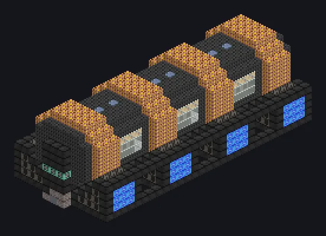

---
tags:
  - Electric processing
---

# Giant Sintering Array

<!-- Generated from the mod code; the structure shown is the smallest variant. -->

*Powder in, solid out. No melting allowed, only patience.*

{ loading=lazy }

| | |
|---|---|
| **Machine type** | Sintering Furnace |
| **Category** | Electric processing |
| **Recipe types** | Sintering Furnace |
| **Size** | 13 × 11 × 31 |
| **Blocks** | 2,351 |
| **Origin** | GregTech Odyssey |

## Description

Fuses powders into dense blocks below their melting point, like real sintering.

- Parallel: the higher of 4^glass tier
- and the Parallel Hatch limit
- Thread Hatch: several recipes at once
- Coil temperature must reach the recipe's
- All glass blocks must be the same tier

## Structure

| Block | Qty |
|---|---:|
| High Temperature Smelting Casing | 678 |
| Naquadah Alloy Casing | 447 |
| Blaze Casing | 288 |
| Cupronickel Coil Block | 224 |
| Cobalt Oxide Ceramic Strong Thermally Conductive Mechanical Block | 144 |
| Assembly Line Grating | 144 |
| Pressure Containment Casing | 120 |
| Enriched Naquadah Frame | 108 |
| Plasma Heater Casing | 64 |
| Iridium Pipe Casing | 62 |
| Tempered Glass | 54 |
| Iridium Gearbox | 6 |
| Muffler Hatch IV | 6 |
| ULV Input Bus | 1 |
| Cleaning Maintenance Hatch | 1 |
| Giant Sintering Array | 1 |
| ULV Input Hatch | 1 |
| ULV Energy Hatch | 1 |
| ULV Output Bus | 1 |

<small>Generated from the mod code; the structure shown is the smallest variant.</small>
