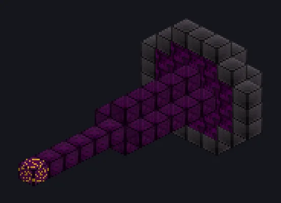

---
tags:
  - Endgame systems
---

# Helioflux Melting Core

<!-- Generated from the mod code; the structure shown is the smallest variant. -->

*Skip the ingot. Go straight to soup.*

{ loading=lazy }

| | |
|---|---|
| **Machine type** | Blast Smelter |
| **Category** | Endgame systems |
| **Recipe types** | Helioflux Melting Core |
| **Size** | 7 × 7 × 13 |
| **Blocks** | 89 |
| **Origin** | GT: New Horizons |

## Description

straight into their liquid form.

- The second Godforge module: melts materials
- Specialized in parallel processing
- Outputs solids if no liquid form exists
- Must be part of a Godforge to work

## Structure

| Block | Qty |
|---|---:|
| Singularity Reinforced Stellar Shielding Casing | 36 |
| Transcendentally Amplified Magnetic Confinement Casing | 21 |
| Boundless Gravitationally Severed Structure Casing | 20 |
| Harmonic Phonon Transmission Conduit | 5 |
| Celestial Matter Guidance Casing | 5 |
| Helioflux Melting Core | 1 |
| Stellar Energy Siphon Casing | 1 |

<small>Generated from the mod code; the structure shown is the smallest variant.</small>
