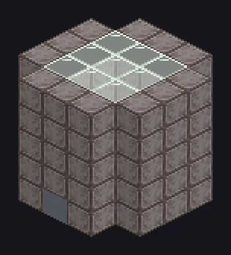

---
tags:
  - Multiblock catalog
---

# Greenhouse

<!-- Generated from the mod code; the structure shown is the smallest variant. -->

{ loading=lazy }

| | |
|---|---|
| **Recipe types** | Greenhouse |
| **Size** | 5 × 5 × 5 |
| **Blocks** | 87 |

## Description

Photosynthesis as a service. Grows crops from a kept seed or plant, water and optional fertilizer.

- Machine Type: Greenhouse
- The seed or plant is never consumed
- Needs sunlight; slows down without it

## Structure

| Block | Qty |
|---|---:|
| ULV Machine Casing | 63 |
| Mud | 9 |
| Tempered Glass | 9 |
| ULV Input Hatch | 1 |
| ULV Output Bus | 1 |
| Cleaning Maintenance Hatch | 1 |
| Greenhouse | 1 |
| ULV Input Bus | 1 |
| ULV Energy Hatch | 1 |

<small>Generated from the mod code; the structure shown is the smallest variant.</small>
