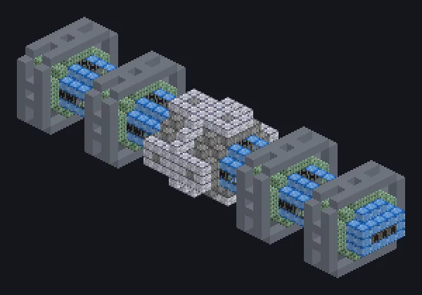

---
tags:
  - Processamento elétrico
---

# Mão de Aracne

<!-- Gerada a partir do código do mod; a estrutura mostrada é a menor variante. -->

*Oito braços, nenhum nó. Aracne teria inveja.*

{ loading=lazy }

| | |
|---|---|
| **Tipo de máquina** | Tear |
| **Categoria** | Processamento elétrico |
| **Tipos de receita** | Tear |
| **Tamanho** | 41 × 9 × 9 |
| **Blocos** | 1.351 |
| **Origem** | GregTech Odyssey |

## Descrição

Um tear gigante que tece fibras e cabos mais rápido que qualquer aranha.

- Thread Hatch: várias receitas ao mesmo tempo
- Aceita Laser Hatches
- Paralelos definidos pelo Parallel Hatch

## Estrutura

| Bloco | Qtd. |
|---|---:|
| Carcaça de Máquina de Pikyônio | 344 |
| Tungsten Frame | 264 |
| Heat Proof Invar Machine Casing | 176 |
| Unidade Avançada de Linha de Montagem | 160 |
| Casing Mecanico de Hastelloy N Resistente a Oxidacao | 136 |
| Laminated Glass | 132 |
| Carcaça de Contenção de Pressão | 91 |
| Caixa de Engrenagens de Amprósio | 37 |
| Assembly Line Grating | 6 |
| ULV Energy Hatch | 1 |
| Cleaning Maintenance Hatch | 1 |
| ULV Input Bus | 1 |
| Mão de Aracne | 1 |
| ULV Output Bus | 1 |

<small>Gerada a partir do código do mod; a estrutura mostrada é a menor variante.</small>
