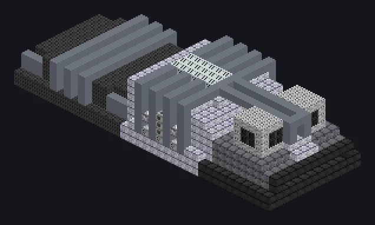

---
tags:
  - Electric processing
---

# Heavy Rolling

<!-- Generated from the mod code; the structure shown is the smallest variant. -->

*Rolls metal like dough. Very hot, very heavy dough.*

{ loading=lazy }

| | |
|---|---|
| **Machine type** | Bender |
| **Category** | Electric processing |
| **Recipe types** | Bender |
| **Size** | 36 × 9 × 13 |
| **Blocks** | 2,144 |
| **Origin** | GregTech Odyssey |

## Description

Heated rolling mills that bend and press plates at industrial scale.

- Thread Hatch: several recipes at once
- Accepts Laser Hatches
- Parallel 2x for each 900K of coil temperature
- Uses the Parallel Hatch limit if higher

## Structure

| Block | Qty |
|---|---:|
| Pressure Containment Casing | 461 |
| High Temperature Smelting Casing | 397 |
| Naquadah Alloy Frame | 231 |
| Hyper Mechanical Casing | 229 |
| Antifreeze Heatproof Machine Casing | 209 |
| Iridium Casing | 156 |
| Amprosium Gearbox | 101 |
| Stress Proof Casing | 86 |
| Cupronickel Coil Block | 76 |
| Tungstensteel Pipe Casing | 68 |
| Amprosium Pipe Casing | 44 |
| Heat Vent | 25 |
| High Strength Support Spindle | 22 |
| Filter Casing | 18 |
| Tempered Glass | 8 |
| Amprosium Casing | 8 |
| Heavy Rolling | 1 |
| ULV Output Bus | 1 |
| ULV Input Bus | 1 |
| Cleaning Maintenance Hatch | 1 |
| ULV Energy Hatch | 1 |

<small>Generated from the mod code; the structure shown is the smallest variant.</small>
