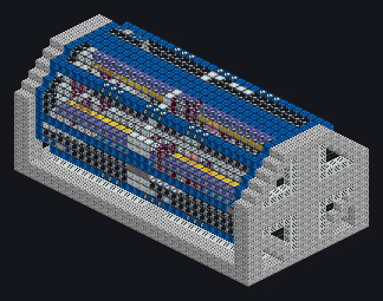

---
tags:
  - Electric processing
---

# High Energy Laser Lathe

<!-- Generated from the mod code; the structure shown is the smallest variant. -->

*Laser blades turn rods. Sawdust is now a hologram.*

{ loading=lazy }

| | |
|---|---|
| **Machine type** | Lathe |
| **Category** | Electric processing |
| **Recipe types** | Lathe |
| **Size** | 33 × 16 × 17 |
| **Blocks** | 3,799 |
| **Origin** | GregTech Odyssey |

## Description

Reshapes matter with photon blades, visible through its transparent casing.

- Thread Hatch: several recipes at once
- Accepts Laser Hatches
- Parallel set by the Parallel Hatch

## Structure

| Block | Qty |
|---|---:|
| Fusion Glass | 1,274 |
| Iridium Casing | 1,075 |
| Molecular Casing | 415 |
| High Power Casing | 236 |
| Filter Casing | 232 |
| Laser-Safe Engraving Casing | 128 |
| Electrolytic Cell | 116 |
| Laser Casing | 108 |
| Electron Permeable Amprosium Coated Glass | 104 |
| Containment Field Generator | 36 |
| Optical Resonance Chamber | 26 |
| Precision Processing Mechanical Casing | 24 |
| Laser Cooling Casing | 8 |
| High Energy Laser Emitter | 8 |
| Amprosium Gearbox | 4 |
| ULV Input Bus | 1 |
| Cleaning Maintenance Hatch | 1 |
| High Energy Laser Lathe | 1 |
| ULV Energy Hatch | 1 |
| ULV Output Bus | 1 |

<small>Generated from the mod code; the structure shown is the smallest variant.</small>
