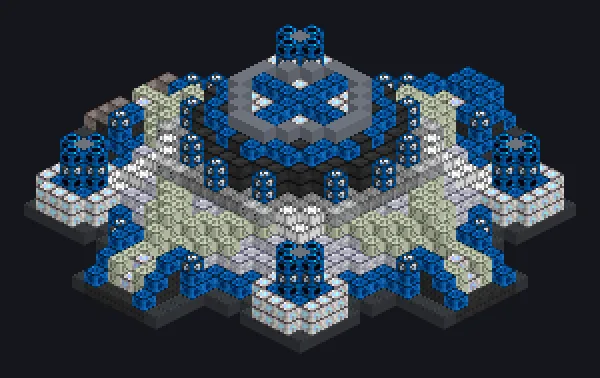

---
tags:
  - Processamento elétrico
---

# Separador Sagrado

<!-- Gerada a partir do código do mod; a estrutura mostrada é a menor variante. -->

*Centrifugação como ritual sagrado de purificação. Amém.*

{ loading=lazy }

| | |
|---|---|
| **Tipo de máquina** | Centrífuga |
| **Categoria** | Processamento elétrico |
| **Tipos de receita** | Centrifuge |
| **Tamanho** | 31 × 11 × 31 |
| **Blocos** | 2.110 |
| **Origem** | GregTech Odyssey |

## Descrição

Uma centrífuga em forma de altar que separa materiais por densidade em escala de megafábrica.

- Thread Hatch: várias receitas ao mesmo tempo
- Aceita Laser Hatches
- Paralelos definidos pelo Parallel Hatch

## Estrutura

| Bloco | Qtd. |
|---|---:|
| Bloco de Base Reforçada | 505 |
| Invólucro Hipermecânico | 345 |
| Carcaça Molecular | 314 |
| Carcaça de Contenção de Pressão | 212 |
| Casco Mecânico Tênsil de Nylon MC | 168 |
| Concreto de Alta Resistência | 108 |
| High Power Casing | 104 |
| Bloco Mecanico Ceramico de Zirconia Resistente a Flexao | 76 |
| Casing Mecanico de Hastelloy N Resistente a Oxidacao | 62 |
| Gerador de Campo de Contenção | 48 |
| Naquadah Alloy Frame | 40 |
| Carcaça Ativa de Amprósio | 40 |
| Caixa de Engrenagens de Amprósio | 33 |
| Invólucro Oco | 32 |
| Invólucro de Injeção Dimensional | 16 |
| Cleaning Maintenance Hatch | 1 |
| ULV Energy Hatch | 1 |
| ULV Output Bus | 1 |
| ULV Input Bus | 1 |
| ULV Output Hatch | 1 |
| ULV Input Hatch | 1 |
| Separador Sagrado | 1 |

<small>Gerada a partir do código do mod; a estrutura mostrada é a menor variante.</small>
