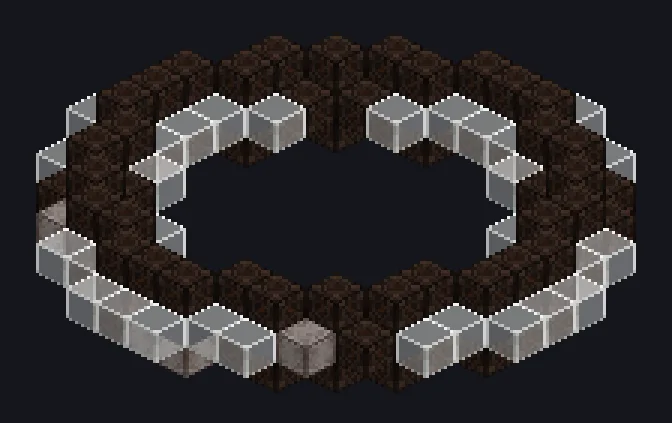

---
tags:
  - Catálogo de multiblocos
---

# Reator de Hiperpressão

<!-- Página gerada a partir do código do mod; a estrutura é a menor variante. -->

{ loading=lazy }

| | |
|---|---|
| **Tipos de receita** | Reator de Alta Pressão |
| **Tamanho** | 15 × 3 × 15 |
| **Blocos** | 160 |

[Guia completo →](../noenergy/hyper-pressure-reactor.md)

## Descrição

Pressão faz diamantes. Também faz isto. Uma câmara de reação de fluidos por pressão que funciona com pura lógica.

- Tipo de Máquina: Reator de Alta Pressão
- Não precisa de Energia nem de Vapor
- Paralelos: 1
- A versão Compacta tem 512 paralelos

## Estrutura

| Bloco | Qtd. |
|---|---:|
| Hyper Pressure Breel Casing | 78 |
| Borosilicate Glass | 45 |
| Breel Pipe Casing | 32 |
| ULV Output Hatch | 2 |
| ULV Input Hatch | 2 |
| Reator de Hiperpressão | 1 |

<small>Página gerada a partir do código do mod; a estrutura é a menor variante.</small>
