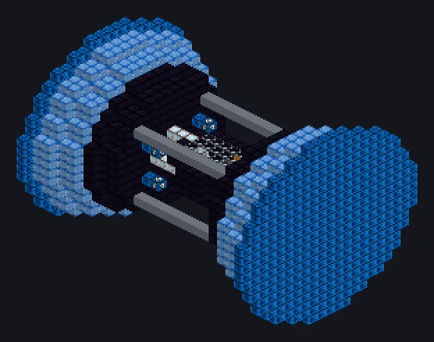

---
tags:
  - 发电
---

# 超能反应堆

<!-- 根据模组代码生成;所示结构为最小形态。 -->

*燃烧超能燃料。别问它哪里“超能”。*

{ loading=lazy }

| | |
|---|---|
| **机器类型** | 发电机 |
| **分类** | 发电 |
| **配方类型** | 超能反应堆 |
| **尺寸** | 27 × 21 × 21 |
| **方块数** | 1,794 |
| **来源** | GregTech Odyssey |

## 说明

将超能燃料转化为大量EU；增压等离子体使每次运行倍增。

- 可朝任意方向建造
- 动力仓或激光源仓
- 增压等离子体：默认16倍并行
- 增压等离子体在每次增压运行前消耗一次
- 增压剂和燃料按配方设置（整合包/KubeJS）

## 结构

| 方块 | 数量 |
|---|---:|
| 分子机械方块 | 674 |
| 强化超能机械方块 | 599 |
| 皮卡优机械方块 | 400 |
| 中子素框架 | 44 |
| 聚变玻璃 | 30 |
| 高能机械方块 | 24 |
| 遏制场发生器 | 8 |
| 超能核心 | 7 |
| 安普洛管道方块 | 4 |
| ULV输入仓 | 2 |
| 超能反应堆 | 1 |
| 超净维护仓 | 1 |

<small>根据模组代码生成；所示结构为最小形态。</small>
