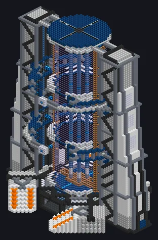

---
tags:
  - Catálogo de multiblocos
---

# Núcleo de Fusão de Plasma Hiperdimensional

<!-- Página gerada a partir do código do mod; a estrutura é a menor variante. -->

{ loading=lazy }

| | |
|---|---|
| **Tipos de receita** | Forja de Plasma |
| **Tamanho** | 63 × 83 × 47 |
| **Blocos** | 23.534 |

## Descrição

Uma Forja de Plasma que aprendeu a multitarefa. Azar do universo. Roda receitas da Forja de Plasma com o calor de bobina de uma DTPF, em paralelo e lado a lado.

- Tipo de Máquina: Forja de Plasma
- Thread Hatch: várias receitas ao mesmo tempo
- Aceita Laser Hatches
- Paralelos definidos pelo Parallel Hatch
- O calor da receita não pode passar o da bobina

## Estrutura

| Bloco | Qtd. |
|---|---:|
| Vidro Energético Reforçado com Rênio | 4.980 |
| Carcaça SPS | 4.794 |
| Bloco de Base Reforçada | 2.916 |
| Carcaça Mecânica de Plástico ABS Branca | 2.174 |
| Invólucro Dimensionalmente Transcendente | 1.923 |
| Neutronium Frame | 1.651 |
| Fusion Glass | 1.357 |
| High Power Casing | 741 |
| Cupronickel Coil Block | 551 |
| Naquadria Frame | 502 |
| Bobina Molecular | 436 |
| Cubo Mecânico Absorvedor de Raios de Cerâmica de Carbonato de Estrôncio | 364 |
| Bloco Mecânico Cerâmico de Óxido de Cobalto Condutor Térmico de Alta Resistência | 356 |
| Concreto de Alta Resistência | 288 |
| Hipernúcleo | 209 |
| Carcaça de Ponte Dimensional | 130 |
| Carcaça Mecânica de Plástico ABS Laranja | 120 |
| Invólucro de Injeção Dimensional | 24 |
| Invólucro Oco | 12 |
| ULV Output Hatch | 1 |
| Núcleo de Fusão de Plasma Hiperdimensional | 1 |
| ULV Input Hatch | 1 |
| ULV Output Bus | 1 |
| ULV Input Bus | 1 |
| ULV Energy Hatch | 1 |

<small>Página gerada a partir do código do mod; a estrutura é a menor variante.</small>
