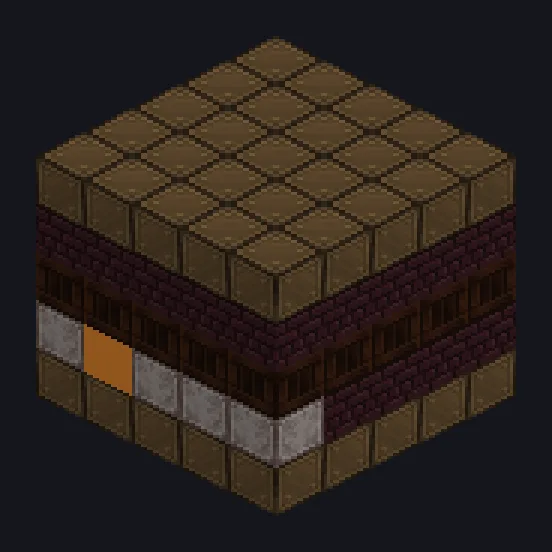

---
tags:
  - 蒸汽与原始
---

# 炼狱焦炉

<!-- 根据模组代码生成;所示结构为最小形态。 -->

*地狱厨房，不过是给煤用的。*

{ loading=lazy }

| | |
|---|---|
| **机器类型** | 炼狱焦炭 |
| **分类** | 蒸汽与原始 |
| **配方类型** | 炼狱焦炭加工 |
| **尺寸** | 5 × 5 × 5 |
| **方块数** | 98 |
| **来源** | GT: Not Leisure |

## 说明

一座运行越久越快的焦炉，每10分钟变得更强。

- 每5秒速度+1%，最高10倍
- 每10分钟：并行+16
- 并行：从8开始，最高256
- 蒸汽：基础6,400 L/s，每阶段+1,600 L/s
- 空闲时速度加成衰减

## 结构

| 方块 | 数量 |
|---|---:|
| 强铜包覆外壳 | 50 |
| Nether Bricks | 26 |
| 布雷尔合金镀层外壳 | 16 |
| ULV输出仓 | 1 |
| 蒸汽输入仓 | 1 |
| 炼狱焦炉 | 1 |
| ULV输入仓 | 1 |
| ULV输出总线 | 1 |
| ULV输入总线 | 1 |

<small>根据模组代码生成；所示结构为最小形态。</small>
